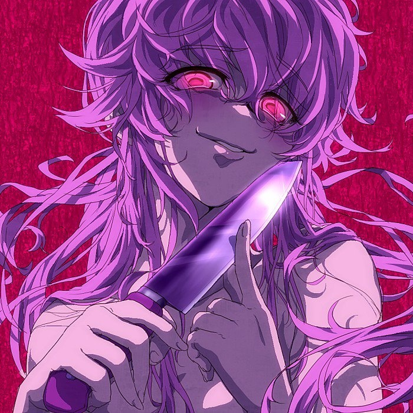

<!-- ═══════════ HEADER ═══════════ -->

<!-- Imagen o GIF principal en tu carpeta /assets -->

 

---

<!-- ═══════════ SECCIÓN DE 3 CARDS ═══════════ -->

 

<table align="center">
  <tr>
    <td align="center" valign="top" width="33%">
      
      <h3>☕ Java</h3>
      
Lógica, arquitectura y proyectos backend o de escritorio.

    </td>
    <td align="center" valign="top" width="33%">
      
      <h3>🎮 C#</h3>
      
Desarrollo de aplicaciones y mecánicas interactivas.

    </td>
    <td align="center" valign="top" width="33%">
      
      <h3>🌙 Lua</h3>
      
Scripting rápido, automatización y personalización.

    </td>
  </tr>
</table>

 

---

<!-- ═══════════ SECCIÓN DE VIDEOS (YOUTUBE Y TIKTOK) ═══════════ -->
<h2 align="center"> Videos & Clips</h2>

 

<table align="center">
  <tr>
    <!-- Columna 1: Formato YouTube (16:9) -->
    <td align="center" valign="top" width="55%">
      <h3> YouTube</h3>
      
      
<b>Título de tu video de YouTube</b> Breve descripción del video.

    </td>
    <!-- Columna 2: Formato TikTok / Short (9:16) -->
    <td align="center" valign="top" width="45%">
      <h3> TikTok</h3>
      
      
<b>Título de tu TikTok</b> Clip rápido o tip.

    </td>
  </tr>
</table>

 

